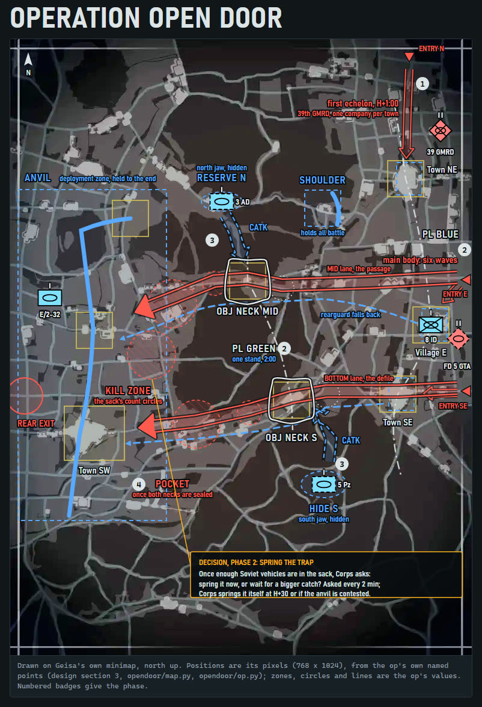
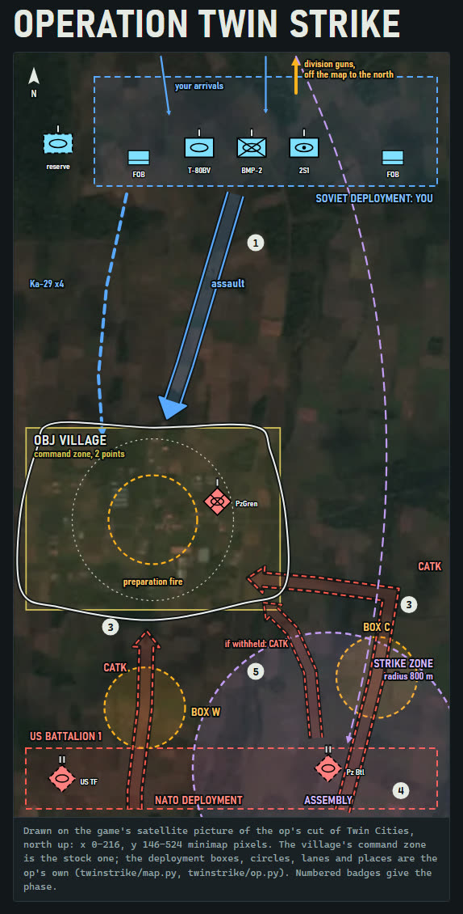
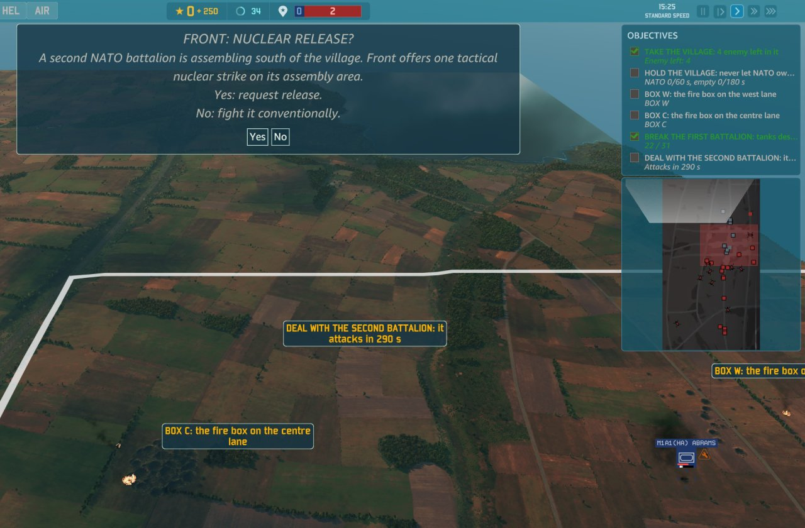
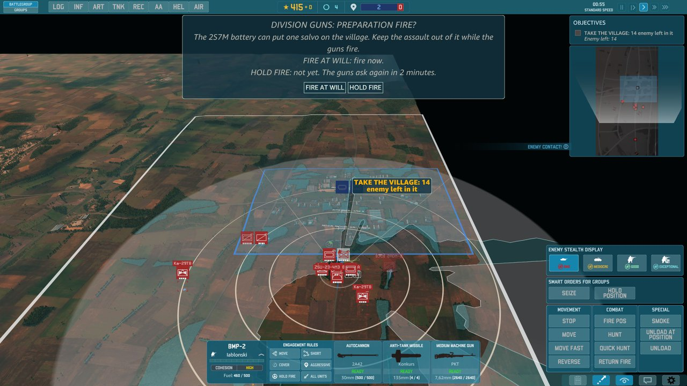
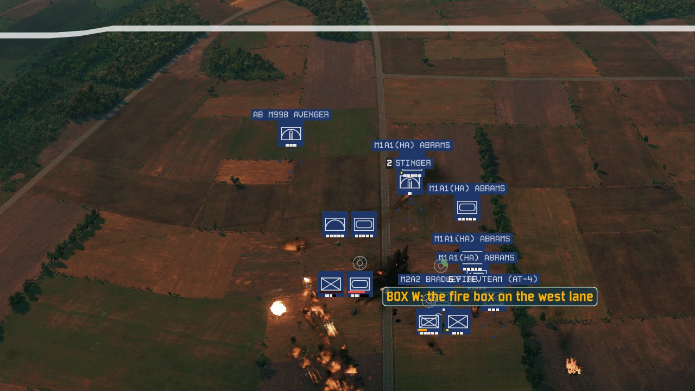

# warno-modkit

A toolkit for WARNO modders who use [Claude Code](https://claude.com/claude-code), starting with scripted custom
Operations: scenario-only mods with stock units.

It is built from **components**. Each one is a Claude Code plugin holding skills (the procedures Claude follows),
the Python scripts they run, worked examples, and a knowledge base of what the game really does, which grows with
every launch, play and stock survey. Components build on each other by importing, never by copying.

**What's new here.** As far as we know (November 2026), this is the first public toolkit that builds complete
scripted single-player Operations for WARNO outside Eugen's editor. One tactical mission can hold decision dialogs,
scripted fires, deck changes and difficulty branches. The nearest earlier work does the same for Eugen's older game
R.U.S.E.; see [Prior art and credits](#prior-art-and-credits).

Before you launch, the toolkit also:
- checks every active mod, Workshop items included, for a clashing menu order, map GUID or scenario id;
- runs the game's own load-time checks, derived from your WARNO.exe, as a gate.

**Status: v0.1, an early demo.** It works end to end: the showcase Operation, [Twin Strike](components/ops/examples/twin-strike/README.md),
builds, loads and plays. But it has been played only a handful of times, so expect rough edges. Play reports and issues are welcome:
every play becomes a record in the knowledge base, and the next version gets better.

Unofficial, and not affiliated with Eugen Systems; see [Notice](#notice).

## What an Operation looks like

| [](components/ops/examples/open-door/README.md) | [](components/ops/examples/twin-strike/README.md) |
| --- | --- |
| [Operation Open Door](components/ops/examples/open-door/README.md): you play NATO | [Operation Twin Strike](components/ops/examples/twin-strike/README.md): you play the Soviets |

These are the authoring pages of the two example Operations: the design schematics each op was built from, in APP-6
symbols over the game's own map, not gameplay. Map imagery from WARNO, (c) Eugen Systems, shown for non-commercial
illustration; not affiliated with or endorsed by Eugen Systems.

**In play: Operation Twin Strike, v0 demo.**

|  |  |
| --- | --- |
| Front offers one tactical nuclear strike on the second NATO battalion; the objectives track the scripted phases. | Mid-assault, the division's guns offer one salvo on the village: fire now, or hold. |



The first NATO battalion's column comes under fire on the west lane. In-game pictures: WARNO's art belongs to Eugen
Systems ([NOTICE](NOTICE)).

## Components

| Plugin | Folder | Holds |
| --- | --- | --- |
| `warno-core` | `components/core` | Setup from your own install; the game's file formats (archives, compiled NDF, dictionaries, textures, scenario Python); the load-time checks a mod must pass and crash-dump triage; the gate framework; mod packaging and the share installer; the knowledge tooling |
| `warno-ops` | `components/ops` | The Operation engine (script graph, script blocks, LevelDesign, zones, re-keying), the build driver `modkit.ops.build` and its gates, and two worked examples: the probes and Operation Open Door |

`warno-ops` depends on `warno-core`; installing it brings both.

### Skills

| Skill | Plugin | Use it to |
| --- | --- | --- |
| `warno-setup` | core | point the toolkit at your install, install the packages, build the stock corpus, derive the load-time rules |
| `warno-stock-precedent` | core | check the knowledge and search stock before relying on anything unproven |
| `warno-gates` | core | run the gates, and add one that models the game's own lookup |
| `warno-launch-triage` | core | go from the game's error to the cause, and end with a gate |
| `warno-probe-and-playtest` | core | design a probe, hand a build over, debrief the play |
| `warno-ship` | core | share a played mod: the one-click installer or the Steam Workshop |
| `warno-localization` | core | put a mod's text into another language: the game's own labels, the language's military register and term table (Simplified Chinese first), a native review |
| `warno-record-finding` | core | record a trial and update what it proved |
| `warno-new-component` | core | add a component in the standard shape |
| `warno-new-operation` | ops | build a new Operation from the examples |
| `warno-op-storyboard` | ops | make an Operation's design page (map, phases, objectives, order of battle) and publish it |

In a session, Claude picks a skill by what you ask; you can also call one by name, as in `/warno-core:warno-setup`.

## What you need

- WARNO, installed through Steam, on Windows
- Python 3.14 or newer (the game's archives are zstd-compressed, which Python reads from 3.14)
- Claude Code

## Game version

This toolkit was verified on WARNO builds **201602** and **210942**. Its core (stock paths, the load-time rules reader,
packaging) has moved to 210942, and Twin Strike played on it
([2026-11-12-twin-strike-210942-play1](components/ops/knowledge/trials/2026-11-12-twin-strike-210942-play1.md)). To see your own, run
`python -m modkit.core.gamebuild`: it prints the installed build and the verified ones, and a `GAME BUILD:` warning
when yours is another. The build driver prints the same warning when it starts. It is a warning only: nothing fails
and no output changes.

Eugen's game updates often change how mods are built and loaded. What changed for mods at 210942, found in
[2026-11-12-build-210942-port](components/core/knowledge/trials/2026-11-12-build-210942-port.md):

- The game's own NDF moved from `Glad.dat` to `Transactions.dat`, and compiled NDF ships as `.txn`, scenario and map
  definitions included: [edat-revision-chain](components/core/knowledge/mechanisms/edat-revision-chain.md).
- The Gameplay files a mod must not ship are now `.txn` files, with `GFX/CriticalEffects` in and
  `GFX/UnitConstantes` out (`modkit.core.packaging.GAMEPLAY_FILES`).
- The load-time rules changed with the classes: [load-time-validation-rules](components/core/knowledge/mechanisms/load-time-validation-rules.md).

What changed for mods at 201602:

- Archives are format version 3 (version 2 up to revision 197351): [edat-revision-chain](components/core/knowledge/mechanisms/edat-revision-chain.md).
- Operations now run from the compiled GDScript: [gdscript-is-what-loads](components/ops/knowledge/mechanisms/gdscript-is-what-loads.md).
- The mod's version line and `[Config]` hashes mark a mod outdated after an update:
  [mod-version-and-config-lines](components/core/knowledge/mechanisms/mod-version-and-config-lines.md).

After an update, follow [After a game update](components/ops/examples/probes/README.md#after-a-game-update): re-run
setup to re-extract (`python -m modkit.core.setup check` reports STALE), rebuild and run the gates, play the probes,
then re-verify the records and bump `last_verified`. Supporting a new build takes a toolkit release, because the
build number is built into the packaging and the stock paths. See also [knowledge/builds.md](knowledge/builds.md) and
[knowledge/topics/game-updates.md](knowledge/topics/game-updates.md).

## Installing the plugins

Add this repository as a plugin marketplace, then install `warno-ops` (which brings `warno-core`):

```
claude plugin marketplace add <this repository: its git URL, or the folder of a clone>
claude plugin install warno-ops@warno-modkit
```

Or inside a session: `/plugin marketplace add ...`, then `/plugin install warno-ops@warno-modkit`. Work in a project
folder of your own: skills, scripts and examples come from the installed copy, and your findings go to your
project's `knowledge/` folder.

**Working on the toolkit itself:** clone it and open the clone in Claude Code. Once you trust the folder, its
`.claude/settings.json` registers the clone as the `warno-modkit` marketplace and enables both plugins, loaded in
place: your edits apply at the next session or after `/reload-plugins`.

## Quick start

1. **Set up:** ask Claude to run `warno-setup`. It makes a Python 3.14 venv, installs the packages, writes your
   `modkit.local.toml`, builds the stock corpus from your install and derives the load-time rules.
2. **Build the example,** Operation Open Door, with the venv's Python:
   `python "<warno-ops folder>/examples/open-door/build.py" --content op --out build/open-door/op`, where the
   folder is the `installPath` that `claude plugin list --json` shows (in a clone:
   `python components/ops/examples/open-door/build.py --content op`). Every gate but the read-back runs before
   anything is written; the read-back then checks the written packs.
3. **Play it:** install the built `OpenDoor` folder (`warno-ship` makes a one-click installer), switch every
   Gameplay mod off, and play with the example's `docs/play-sheet.md` beside you.
4. **Build your own:** `warno-new-operation` walks you from the smallest probe to a mission of your own.

## The knowledge map

What the components know is kept in layers:

- **[knowledge/README.md](knowledge/README.md)** is the page to read first. It says where each kind of question
  starts and lists the **topics**, such as zones and map or game updates, with how many mechanisms each holds and how
  many of those were played.
- **One page per topic** in `knowledge/topics/`, plus pages for the **symptom index** (the game's own words for a
  failure, the mechanism behind it, and the gate that now catches it), the mechanisms by **status** (`PLAYED`,
  `PROBED`, `RE`, `STOCK`, `FAILED`, `UNTESTED`), the **game builds** each fact was checked on, the **trials**,
  newest first, and the **lessons** they taught.
- **The records themselves**, one fact per file, in each component's `knowledge/` folder: `mechanisms/`, `trials/`
  and `lessons/`, with the component's topics declared in `topics.md`.

The `knowledge/` folder and each component's `knowledge/INDEX.md` are generated from the records. Skills, code and
examples cite records as `[[id]]` rather than restating them; `python -m modkit.core.knowledge check .` keeps every
citation pointing at a real record. [docs/case-study.md](docs/case-study.md) tells how the Open Door example was
built and played.

## Known limitations

> **Operations and Gameplay mods don't mix.** If any active mod changes unit data (a Gameplay mod, in the Mod
> Center's terms), starting an Operation makes WARNO relaunch with every mod switched off. Everything here therefore
> ships scenario-only, with stock units. There is a way around this, but it is outside the scope of this repo.

- **One map is ready.** Geisa is the only stock map with its facts recorded; another map takes a declaration of its
  stock files and a probe first.
- **The opening camera** starts in a map corner in Open Door and the probes: they set none. Twin Strike flies a
  stock-style opening move after LoadingDone, not yet played; v0.1's snap before LoadingDone left it on the ground.
- **Game updates:** each mechanism records the game build it was last verified on. After an update, `warno-setup`
  re-checks your corpus and rules, and every mod should be rebuilt and played again.
- **Windows:** the share installer is a Windows `.cmd`.

## What reads your game, and why

The toolkit ships no game data. `warno-setup` builds what the components need from your own install, read-only,
and never writes to the game folder. One module of `warno-core` reads your own game executable, read-only, to find
the load-time checks your mod must pass, and reads the error message in your own crash dumps. It writes nothing to
the game and does nothing else with it.

## Develop

To work on the repository itself, for example in PyCharm.

**Python 3.14 is required.** The game's archives are zstd-compressed, and Python reads zstd from 3.14. An older
`python` on your PATH fails, so make the venv with the launcher and use its interpreter for everything:

```
py -3.14 -m venv .venv
.venv/Scripts/python -m pip install -e components/core -e components/ops
```

If pip cannot fetch setuptools, install `setuptools>=69` once and add `--no-build-isolation`.

**PyCharm:**

- **Interpreter:** Settings > Project > Python Interpreter > Add Interpreter > Add Local Interpreter > Select
  existing, and pick the `python` in the repository's `.venv/Scripts/` folder.
- **Tests:** one run configuration per component. Run > Edit Configurations > + > Python, switch the target from
  script to module, and set:
  - module: `unittest`
  - parameters: `discover -s components/core/tests -t components/core/tests` (and `components/ops/...` for the
    second)
  - working directory: the repository root
  - interpreter: the project's `.venv`
- **Imports:** if the editor doesn't resolve `modkit.*` or the examples' packages, mark each `components/<name>/src`
  and each `components/ops/examples/<example>` folder as a Sources Root. Runs use the venv either way.

The same commands work in a terminal:

```
.venv/Scripts/python -m unittest discover -s components/core/tests -t components/core/tests
.venv/Scripts/python -m unittest discover -s components/ops/tests -t components/ops/tests
```

or both as CI runs them (ops one module per process), with the tests run and skipped per suite:
`.venv/Scripts/python tools/run_tests.py`.

**Your game and corpus:** run `warno-setup` once. It writes `modkit.local.toml` at the repository root (git-ignored)
with `game_dir` (your WARNO folder), `extracted` (the stock corpus, outside the repository and the game folder) and,
optionally, `data_dir`, `build_dir` (where builds write by default; `build/` beside the toml, or in the working
folder without one) and a `deny` list of personal strings the hygiene check refuses. The variables
`MODKIT_GAME_DIR`, `MODKIT_EXTRACTED`, `MODKIT_DATA` and `MODKIT_BUILD` override the file. With neither, the tests
that need stock data skip with a message naming `warno-setup`, and a build stops with one `FAILED:` line naming it.

**Before committing:**

```
.venv/Scripts/python -m modkit.core.knowledge render
.venv/Scripts/python -m modkit.core.knowledge check .
.venv/Scripts/python -m modkit.core.repocheck --history .
```

and both test runs. `render` regenerates the `knowledge/` folder (its README, the topic pages and the symptom,
status, build, trial and lesson pages), every component's `INDEX.md` and the "referenced by" footers of the
mechanism and lesson pages, and deletes a generated page it no longer writes: commit them with the change.
`repocheck` checks each component's shape and dependencies, the knowledge, and the public-repository hygiene over
every commit: no game data, no local paths or personal data, no references to components this repository does not
hold. After changing a manifest, also run `claude plugin validate .` and `claude plugin validate components/<name>`.

**CI** (`.github/workflows/ci.yml`) runs on every pull request to `main` and every push to it, on Windows with
Python 3.14: `ruff check .` (bug rules only, set in `ruff.toml`; the version is pinned in the workflow), the knowledge
check, `knowledge render` (which must leave no diff), `repocheck --history`, `claude plugin validate` on the
marketplace and both plugins, and `tools/run_tests.py` (the core suite, the ops suite one module per process). CI has
no game data, so the tests that need it skip and the run's summary says how many: a green run is not a full run.

## Layout

```
.claude-plugin/marketplace.json   the marketplace: one plugin per component
.claude/settings.json             registers this clone's marketplace and enables its plugins
.github/workflows/ci.yml          CI: lint, the repository checks and both test suites
ruff.toml                         the lint rules
tools/run_tests.py                runs both test suites as CI does (dev tooling, in no plugin)
components/<name>/                one component: .claude-plugin/plugin.json, pyproject.toml, src/modkit/<name>/,
                                  skills/, examples/, knowledge/, tests/
components/<name>/knowledge/      its records, one per file: mechanisms/, trials/, lessons/; its topics.md;
                                  INDEX.md (generated)
knowledge/                        the knowledge map (generated): README.md first, then topics/ and the
                                  symptom, status, build, trial and lesson pages
docs/case-study.md                how the Open Door example was built
NOTICE                            the notice below, in full
```

## Prior art and credits

warno-modkit builds on earlier work by the Eugen modding community.
- **Wargame:** Eugen's binary formats were documented and implemented publicly for the Wargame games by
  moddingSuite (is-consulting/moddingSuite and the kilivan4iK fork) and ev1313's wgrd tools, among others.
- **Current WARNO builds:** [murmax/WarnoArmyGeneralFramework](https://github.com/murmax/WarnoArmyGeneralFramework)
  builds standalone Army General campaigns.
- **What was used:** that framework's source and moddingSuite's format notes were a reference for several format
  details here (compression modes, value tags, archive checksums and alignment, dictionary key order).
- **Two practices followed:** this toolkit follows two of the framework's practices. It clones a stock scenario to a
  new identity rather than overriding it, and it pins each build to the exact game files it was checked against.
- **The code:** the code in this repository is its own standard-library implementation, checked against the files of
  a WARNO install.

Related projects, as of November 2026:
- [sneadtristen6/R.U.S.E-2.0-Project](https://github.com/sneadtristen6/R.U.S.E-2.0-Project) authors Operation
  mission scripts for Eugen's R.U.S.E.
- PiggiesAndBear's ndfbin editors edit WARNO's compiled unit and deck data, and the same author's agent skill covers
  WARNO NDF modding.
- [dary1337/YSM_Installer](https://github.com/dary1337/YSM_Installer) installs and activates WARNO mods.
- [Ulibos/ndf-parse](https://github.com/Ulibos/ndf-parse) parses NDF text.
- Eugen Systems' own modding tools and manuals document the mod layout this toolkit packages for.

If we have missed or misdescribed a project, see [MAINTAINERS.md](MAINTAINERS.md).

## Notice

warno-modkit is unofficial. It is not affiliated with, endorsed by, or supported by Eugen Systems. WARNO is a
trademark of Eugen Systems, and its name is used only to say what the toolkit works with.

- **No game data.** The repository contains no files, tables, text or other data from WARNO. The tools act only on
  your own install, and the mods they help you make contain modified Eugen game data, which stays under Eugen's
  end-user licence agreement.
- **Single-player scope.** Everything here is for single-player scenario mods. Nothing here modifies the game's
  executable or touches multiplayer.
- **Not legal advice.** The tools are provided as they are. Back up your saves and your mod folder before installing
  anything.

The full text is in [NOTICE](NOTICE).

## Licence

The repository's own code and text are under the MIT licence: see [LICENSE](LICENSE). That licence grants nothing over
WARNO, its executable or its data (see [NOTICE](NOTICE)). Where to send requests, corrections and removal requests
is in [MAINTAINERS.md](MAINTAINERS.md).
