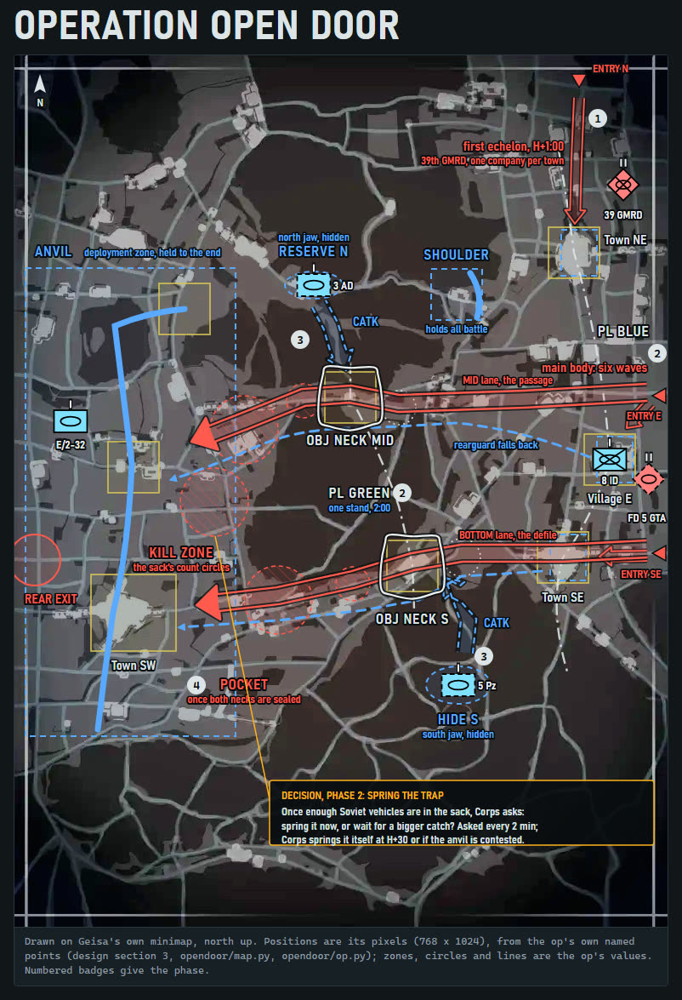

# Operation Open Door: a playable Operation built from stock parts

Three weeks into the war, NATO holds a salient across the border at Geisa. It knows a Soviet counter-stroke is coming
to retake Fulda, and lets it in: a worn rearguard gives ground and draws the Soviets out onto open ground in front of an
anvil far to the rear, and then you pick the moment to shut the door behind the forward detachment of the 5th Guards
Tank Army's lead division.

[](/docs/screenshots/open-door-authoring-page.jpg)

The authoring page, `docs/authoring-page.html`, is the design page this op was authored from: a schematic, not
gameplay (click the map for the whole page). GitHub shows HTML as source, so download the file and open it in a
browser. Map imagery from WARNO, (c) Eugen Systems, shown for non-commercial illustration; not affiliated with or
endorsed by Eugen Systems.

Open Door is the flagship example of the shared Operation driver, `modkit.ops.build`. It is a clone of the stock
challenge Survivors moved onto the stock map Geisa (`modkit.ops.profile.SURVIVORS`, `modkit.ops.maps.GEISA`)
[[custom-operation-from-stock-parts]], with a generated LevelDesign, zone files, GDScript and English and Simplified
Chinese dictionaries. It uses vanilla units only and ships no Gameplay file, so it stays a scenario-only mod
[[gameplay-mod-relaunch]].

| `--content` | Scenario, mod folder | What it is |
|---|---|---|
| `op` | `challenge_OperationOpenDoor`, `OpenDoor` | The playable core: phases 1 to 4, their primaries, B1 and B6, the endings |

It installs beside the probes (`components/ops/examples/probes/`): each has its own scenario, GUID, mod folder and
menu texts [[content-identity-unique]]. Its menu order (`OrderToChainMission` 1001) is shared with the probes `empty`,
`spike`, `spike_safe` and `spike2`, so never have it active with one of them.

## Build

```
python build.py --content op [--out DIR]
```

`DIR` defaults to `open-door/op` in the build folder: `build/` beside your `modkit.local.toml` (in the working
folder without one), unless its `build_dir` or `MODKIT_BUILD` names another (`modkit.core.paths.build_root`). The
output is the mod folder (`OpenDoor/Config.ini`, `Gen/Version.ndf`, the scenario's `Definition`, `Details` and
`Assets` packs), `MANIFEST.tsv` (every packed entry and where it came from), `dumps/` (a typed dump of each generated file) and `od_overlay.png` (every item on Geisa's
Preview, for review). The build needs the stock extraction and the game folder (the `warno-setup` skill). Nothing is
read from either until a build runs: unconfigured, the build prints one `FAILED:` line naming `warno-setup` and exits 1.

Every gate of `modkit.ops.build` runs before anything is written (strings, canonical layout and stock shapes, the
game's load-time property rules, bindings and references, arrivals and tiers, the mission's script rules, the dump
diff, the package), and every written pack is read back. Open Door adds four extra gates (`opendoor/profile.py`):

| Gate | What it holds |
|---|---|
| `units` | every unit the generated files name is in the game's unit database |
| `no-template-name` | no re-keyed or generated file still names Survivors |
| `grid` | Geisa's AI grid, as shipped, spans the playable zone it ships under, by stock's rule |
| `zone-layout` | the shipped zones and arrivals keep stock's layout rules (copies agree, centroids, inside the playable zone, every player arrival ending in a player zone) |

A failed gate prints one `FAILED:` line and exits 1.

## Play

Install the built `OpenDoor` folder (the `warno-ship` skill makes a one-click installer), switch every Gameplay mod
off, and play one Medium run with `docs/play-sheet.md` beside you. Record what you see as a trial (the
`warno-record-finding` skill).

## Docs

- `docs/design.md`: the full mission design, section by section, each marked with what the playable core builds and
  what waits for a later build (the code cites its sections as "design 5.4" and so on).
- `docs/authoring-page.html`: the authoring page: the playable core's plan in APP-6 symbols over Geisa's minimap, with
  the phases, objectives, endings, difficulty and order of battle. One self-contained file: download it and open it in
  a browser.
- `docs/storyline-map.html`: the storyline drawn over Geisa's minimap, stepped by phase, with the objective and force
  boards. The map picture is the game's own, so it is not shipped: open the page and load `od_overlay.png` from a
  build (or any picture of Geisa's minimap) as its base.
- `docs/play-sheet.md`: what to look at in one run, and what to report.

## What the core relies on

The mechanisms the mission stands on, each recorded in the ops knowledge base (`components/ops/knowledge/`) with how
it was settled:

- The deployment phase and its arrival entries: [[deployment-phase-recipe]], [[arrival-end-in-zone]]. The tier entries
  move the player's arrivals back as each line falls.
- PL BLUE's towns fall by capture or by a count race, then their zones are forced: [[zone-capture-command-units]],
  [[count-race-forced-owner]], [[zone-lookup-by-point]].
- The waves keep to the roads: [[fast-move-and-attack-keeps-roads]]. B1 counts kills by type: [[kill-counts-by-type]].
- The spring dialog is asked again until answered: [[dialog-reask-loop]], with stock buttons:
  [[dialog-button-ingame-dictionary]].
- The jaws are hidden units revealed by SpawnUnits; the waves are created at their tags: [[spawn-and-create-units]].
  The deck gains cards with AddUnitToDeck: [[add-unit-to-deck]].
- The sack and the pocket are counted in circles: [[detector-circles-only]]. The pocket's surrender removes it with
  Vanished, after every count: [[vanished-removal]].
- Objectives show counters and finish only once resolved: [[objective-counters]], [[objective-waits-until-resolved]],
  [[objective-label-needs-position]].
- The script alone ends the battle, through one funnel: [[mission-ends-only-by-script]]. The difficulty reaches the
  script through three branches: [[difficulty-branches]]. A dialog takes no variables:
  [[dialog-text-takes-no-variables]].
- How the script's containers run: [[script-container-semantics]], [[seteffect-never-finishes]].

## Shared with the probes

The places on Geisa and the Soviet force groups the probes use too are kept once, in the library:
`modkit.ops.maps.GEISA_POINTS` and `GEISA_BOXES`, and `modkit.ops.forces.GEISA_SOVIET_ROWS`. Open Door keeps only
its own points and rows beside them; the tests check that no shared value is copied.

## Layout

- `build.py`: the command line (`modkit.ops.build.cli` over Open Door's profile and `CONTENTS`)
- `opendoor/profile.py`: the identity and the profile (Survivors on Geisa, the camps, the re-keying, the extra gates)
- `opendoor/map.py`: the named points (the shared ones and Open Door's own); `python -m opendoor.map overlay OUT.png`
  draws them on Geisa's Preview
- `opendoor/forces.py`: the force table, the scale knob and the share thresholds
- `opendoor/strings.toml`: the string table, English and Simplified Chinese side by side: one section per token, one
  key per language (`modkit.ops.strings.load`)
- `opendoor/op.py`: the mission: its geometry, beats, script and content. The composed pieces other ops use too
  (the script frame, lanes and waves, boarding, the re-ask loop, the zone race and hand-over, the end funnel, the
  difficulty branches) are `modkit.ops.mission`'s; `op.py` passes them Open Door's names and values

The tests are `components/ops/tests/test_open_door_*.py` (with `open_door_support.py`).
