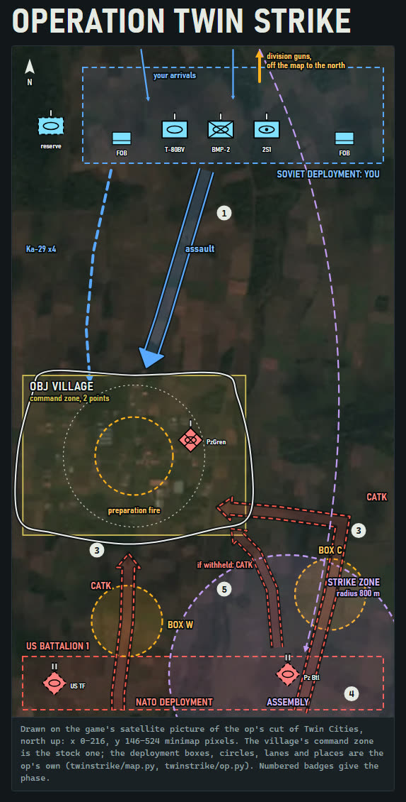

# Operation Twin Strike: the showcase Operation

Early July 1989. A Soviet tank division's forward detachment must seize a road-junction village at the western edge of
Twin Cities, then hold it against two NATO blows, and decide whether to ask Front for one tactical nuclear strike on the
second. You play the Soviets.

> **v0 demo.** Twin Strike has been played once. The fixes from that play are built but not yet played:
> - transports for the infantry;
> - the battlegroup view of the buy menu;
> - division guns created in your allied camp for each fire;
> - garrison and wave orders;
> - the release dialog;
> - the economy;
> - NATO fighter sweeps;
> - a strike you can see: massed explosions, a camera move to it, and a second battalion left for you to finish.
>
> Known issues:
> - RedJuggernaut's stock cards still show in the buy menu beside the op's own (the op is getting its own deck).
> - The division's guns fire from your allied camp, which no stock Operation does; in the first play, allied guns placed
>   at the start drove toward the front.
>
> Tell us what you see: each play becomes a record in the knowledge base.

[](/docs/screenshots/twin-strike-authoring-page.jpg)

The authoring page, `docs/authoring-page.html`, is the design page this op was authored from: a schematic, not
gameplay (click the map for the whole page). GitHub shows HTML as source, so download the file and open it in a
browser. Map imagery from WARNO, (c) Eugen Systems, shown for non-commercial illustration; not affiliated with or
endorsed by Eugen Systems.

Twin Strike is the toolkit's showcase example: a clone of the stock challenge Survivors (`modkit.ops.profile.SURVIVORS`)
moved onto a cut of the stock map Twin Cities (`modkit.ops.maps.TWIN_CITIES`, `twinstrike.map.CUT`)
[[custom-operation-from-stock-parts]] [[ai-grid-tiles-playable-zone]], with the player's camp flipped to the stock
Soviet-player shape (`modkit.ops.profile.SOVIET_PLAYER_CAMP_ROWS`) [[soviet-player-camp]]. It uses vanilla units only
and ships no Gameplay file [[gameplay-mod-relaunch]]. Its design is `docs/design.md`.

| `--content` | Scenario, mod folder | What it is |
|---|---|---|
| `op` | `challenge_OperationTwinStrike`, `TwinStrike` | The whole op: five phases, the division's fires, the strike, three difficulties, three endings and three defeats |

It installs beside Open Door and the probes: each has its own scenario, GUID, mod folder and menu texts, and Twin
Strike its own menu order, `OrderToChainMission` derived from its scenario GUID
(`modkit.ops.leveldesign.derived_menu_order`) [[content-identity-unique]].

Its Operations menu reads as a stock Operation's: a dated briefing in four numbered points, the forces line, the
background under the title and the two outcome texts, each in stock's form and length (`twinstrike/strings.py`), under
the emblems of RedJuggernaut, the 79th Guards Tank Division's stock Operation (`profile.MENU_ART`, the toolkit's
`OpProfile.menu_art`). The map picture is its own card, generated at build time from Survivors'
(`modkit.ops.menuart`): retitled TWIN STRIKE, the cut of Twin Cities in place of Survivors' map, and on it the
Soviet ground in red with the star and the NATO ground in blue with its badge (`profile.CARD_ZONES`,
`profile.CARD_STICKERS`).

## The op

| Phase | What happens | Ends when |
|---|---|---|
| 0. Deploy | Buy and place the forward detachment in the north box (3,000 points, no income yet) | You launch the battle |
| 1. Assault | Take the village from its West German garrison, which holds it. Division guns offer a preparation fire on it. | The village falls: few of its defenders left and one of your command units inside. Lost at 20 min. |
| 2. Unlock | The division's reserve joins your deck, with 8,000 points and an income of 500 from then on; NATO's recon moves north | 2 min |
| 3. Counter-attack | A US armoured battalion comes up both lanes, its recon screen first, then company teams with their air defence, each attacking your units once in the village; NATO fighters sweep the boxes. Fire missions on BOX W or BOX C, and one division fire plan. | The battalion is broken, or 15 min on (its survivors break off) |
| 4. Surprise | A West German Panzer battalion appears at the assembly area: it attacks in 5:00. Front offers nuclear release. A strike guts it; you finish it. | After a strike, the battalion broken (20 min at most); or the countdown runs out |
| 5. Hold | Hold the village; HOLD ON, on the village and in the objectives, shows the time left | 5 min after a struck battalion is broken; after withholding, until the second battalion is broken, up to 20 min; at once when NATO has no ground unit left |

You lose if NATO owns the village for 60 s, or none of your units is inside its zone for 3 min (from phase 2 on). A win is
Total (the village held, both battalions beaten: the first broken, the second destroyed or broken), Minor (held, but
you lost more than half of what you bought) or Major; the end dialog names it and whether the strike was released or
withheld. Difficulty moves the garrison's breaking point, the first battalion's company teams and the fire-mission
cooldown.

## Build

```
python build.py --content op [--out DIR]
```

`DIR` defaults to `twin-strike/op` in the build folder: `build/` beside your `modkit.local.toml` (in the working folder
without one), unless its `build_dir` or `MODKIT_BUILD` names another (`modkit.core.paths.build_root`). The output is the
mod folder (`TwinStrike/Config.ini`, `Gen/Version.ndf`, the scenario's `Definition`, `Details` and `Assets` packs),
`MANIFEST.tsv`, `dumps/` (a typed dump of each generated file) and `ts_overlay.png` (every item, the cut, the zones,
the circles and the arrivals on Twin Cities' Preview, for review). The build needs the stock extraction and the game
folder (the `warno-setup` skill). Nothing is read from either until a build runs: unconfigured, the build prints one
`FAILED:` line naming `warno-setup` and exits 1.

Every gate of `modkit.ops.build` runs before anything is written (the end funnel and the script-effects gate among
them), and every written pack is read back. Twin Strike adds six extra gates (`twinstrike/profile.py`):

| Gate | What it holds |
|---|---|
| `units` | every unit the generated files name is in the game's unit database |
| `no-template-name` | no re-keyed or generated file still names Survivors |
| `grid` | the shipped playable zone and AI grid are the cut's: 40 tiles of the layout's own grid (`CUT.gate()`) |
| `zone-layout` | the shipped zones and arrivals keep stock's layout rules |
| `menu-order` | its menu order is no stock Operation's |
| `fire-range` | each fire's battery, created at `TS_GunSpawn`, is in your alliance, so your units never engage it, with every target inside each battery's range band from where it stands (`modkit.ops.gates.check_fire_range`); the build's own gate keeps every created unit inside the playable zone |

The camera paths file, the opening camera's and the strike's shot, is held to the camera gate when the build plans it
(`modkit.ops.maps.check_camera_paths`): stock's key shape, the move then its last key, the shot one key, every eye over
the map and at least 376,057 world units above the ground (stock's lowest start camera), and the last view and the
shot's inside the cut.

A failed gate prints one `FAILED:` line and exits 1.

## Install and play

`python -m modkit.core.install build/twin-strike/op/TwinStrike --title "Operation Twin Strike"` packs the built mod
folder as a zip with a one-click `.cmd` installer, in `share/` in the build folder (the `warno-ship` skill). Run the
installer, switch every Gameplay mod off, and play one run with the play sheet below beside you. Record what you see as
a trial (the `warno-record-finding` skill).

**After the first Workshop upload,** set `WORKSHOP_ID` in `twinstrike/profile.py` to the new item's ID and commit. The
upload writes that ID into the installed `Config.ini` only, and every build writes `ID = 0`: without it, the next build
and reinstall reset the ID, and the next upload creates a second Workshop item instead of updating the first. (The share
installer also keeps an installed non-zero ID over a build's 0, and refuses a build with a different non-zero one.)

## Play sheet

Play one run on Medium. Answer each question with what the map shows; a number or a yes/no is enough. Every phase
announces itself with a hint, so what you see can be matched to the sheet. (The first play's answers are trial
`2026-11-11-twin-strike-play1`; this sheet is for the next.)

**Loading and the deploy screen**
1. Does the op load, past the deploy screen, with the map clipped to the cut: the village in the south-west, your
   deployment box north of it, nothing playable east of the valley?
2. Does the buy menu open on the BATTLEGROUP view, with the Ka-29s, the Ural and Mi-8TZ supply and the start cards in
   it without switching? Is the switch to the GROUPS view still there? Do the engineers and scouts come in their
   MT-LBs and UAZs, and the two Konkurs-M ATGM teams in their BTR-80s?
3. Does the deploy screen open with a camera move of about 8 s, from high over the whole cut down to a view facing
   south, your deployment box in the near part of it and the village beyond? Does Escape skip straight to that view?
   Do you start with 3,000 points and no income?

**The guns** (no gun stands on the map at the start: friendly guns appear in the north-west forest corner for about 2
minutes per fire, then vanish)
4. Do friendly 2S7Ms or BM-27s appear in the north-west forest corner for each fire, stay there, and vanish about 2
   minutes later? Do your units leave them alone?
5. Does each ordered fire land where it was named, about 50 s after you answer: the village for the preparation fire,
   BOX W or BOX C for a fire mission, the fuller box for the fire plan? Does each battery fire one salvo and stop?

**Dialogs and hints**
6. Do the dialogs read right, and does each button do what the text says: the preparation fire (FIRE AT WILL / HOLD
   FIRE), the fire mission (ROCKET / ARTILLERY, then ALPHA / BRAVO), the fire plan, the release (Yes / No)?
7. Did you see each phase's hint: PHASE 1, the difficulty, the preparation fire's warning, "Village taken", PHASE 3,
   the first battalion broken (or breaking off), the second battalion, the release (granted or withheld), PHASE 5?
8. Are the labels where they belong: P1 and P2 on the village, BOX W and BOX C on their roads, the second battalion's
   countdown and STRIKE ZONE at the assembly area? Does B1's tanks-destroyed count match the Abrams you saw destroyed,
   by your units and by the guns?

**The battle**
9. AI pathing: do the first battalion's columns drive up the roads (the main road through BOX W; the east road through
   BOX C, then west across the stream) into the village, and once there keep attacking your units rather than stand?
   Does the garrison fight from the village (into the houses, or holding its ground)?
10. At the fall, did the village's zone turn yours, did 8,000 points arrive and then 500 a minute, and did the locked
    cards (Tunguska, Su-24M, Mi-24P) unlock and the reserve (T-80U obr. 1989, Ka-50, the Konkurs-M teams in BTR-80s,
    the two Kubs and the rest) appear in the buy menu? Did the forces feel even against each battalion?
11. The frame rate at the peak, when the second battalion appears with the first's survivors and your force on the
    map: smooth, or stuttering?

**The strike** (answer Yes to the release). What it should look like: 25 s after Yes the camera flies to the
assembly area by itself; at 0:30 big explosions burst across the whole zone at once, then white and black smoke and
burning wrecks that last minutes; part of the second battalion dies in the blasts, and the rest is left reeling for you
to finish.
12. Did the release dialog show (after the fire plan too)? Did the camera fly to the zone in about 4 s, wherever you
    were looking, hold it about 11 s with your orders blocked, then hand control back? Does Escape skip the move?
13. Did the flash read as one massive strike, or as scattered shells? How much of the zone did it cover from the
    camera's view? Did the frame rate hold?
14. Kill (new: kill by spawn tag): about half of the second battalion should die on Easy, 40 % on Medium, 30 % on
    Hard, tanks and Marders both. Roughly how many died? Did they leave wrecks, or vanish?
15. Damage and stun (new: no stock script damages or stuns this way): did the survivors' health drop (vehicles to about
    half)? Did they stop firing or moving for a while, and for how long?
16. Did "FINISH THE SECOND BATTALION: N tanks left" show at the assembly area, count down as you killed tanks, and
    complete at 9 left with "The second battalion is broken"? Did the survivors fight back when you went in?

**The end** (after a strike: once the second battalion is broken, HOLD ON counts down from 5:00 on the village and in
the objectives, BOX W and BOX C are done, and the end dialog comes at 0:00, or at once when NATO has no ground unit
left)
17. Did the end come so? Which ending was reached (the end dialog's first line and its last sentence), and on which
    difficulty?

**Supply**
18. Were the supply trucks (Ural-4320 ×4) and supply helicopters (Mi-8TZ ×2) in the buy menu from the start, and could
    they deliver supply to your units?

**The new pieces**
19. NATO fighters: did two F-15Cs come over BOX W about 2:30 into phase 3, and two over BOX C at 6:00? Did they leave
    once spent?
20. The empty-village warning: did it show only after your units had been out of the village's zone for 20 s, while P2
    counted the empty clock?

## What the op stands on

- The Soviet player: the stock camp shape and RedJuggernaut's deck, as probe 3's `nuke_sov` built it
  [[soviet-player-camp]].
- The deployment phase and its arrivals ending in the Soviet box: [[deployment-phase-recipe]], [[arrival-end-in-zone]].
- The garrison is pre-placed, standing from the start, and holds the village by stock's orders
  [[garrison-roe-and-hold]]; the second battalion and the fighters are pre-placed hidden and revealed:
  [[spawn-and-create-units]] [[scripted-air-sweep]]. The circles are detectors: [[detector-circles-only]].
- The economy: 3,000 points with no income, then 8,000 and an income at the fall, set by the balance's ratios
  (design 6.5) [[scripted-economy]].
- The deck: AddUnitToDeck adds only what RedJuggernaut's deck lacks, and LockDeckUnit holds its defence types back
  until the village falls: [[add-unit-to-deck]]. It adds the Soviet player's supply too: the deck has no supply
  helicopter, and its supply trucks sit only in the tank battalions' groups [[soviet-player-camp]].
- The fall: a count in the village's circle and a command unit inside, then the zone forced to the player
  [[count-race-forced-owner]] [[zone-capture-command-units]].
- The waves and lanes: [[fast-move-and-attack-keeps-roads]], each ending with an Attack on your units
  [[wave-ends-with-attack]]; B1's count, battalion 1's tanks created less those alive: [[kill-counts-by-type]].
- The fires: ShootOnPosition from a battery created for each fire in your allied camp, inside the playable zone, and
  removed after [[scripted-fires]] [[created-units-stand-in-zone]]; the dialogs [[dialog-reask-loop]]
  [[dialog-button-ingame-dictionary]].
- The strike: 97 self-contained script effects at once [[script-effects-self-contained]] (the nuke impact effects
  crash a script [[scripted-nuke-effect]]), the camera flown to the zone [[camera-shot-from-current-position]], then a
  share of the second battalion killed by its spawn tags and the rest in the zone damaged and stunned with ChangeStress
  [[changestress-damagetype-zero]], for you to finish.
- The endings: [[mission-ends-only-by-script]], phase 5's end clock shown as a stock objective timer
  [[objective-counters]]; the difficulty: [[difficulty-branches]].
- The opening camera: after LoadingDone, a three-key move from high over the cut down to the Soviet box and the
  village, then a snap to its last key, as stock opens a deployment-phase Operation; a snap before LoadingDone, as v0.1
  shipped, left the camera on the ground [[start-camera-before-loading-done]].

## Layout

- `build.py`: the command line (`modkit.ops.build.cli` over Twin Strike's profile and `CONTENTS`)
- `twinstrike/profile.py`: the identity and the profile (Survivors on the cut, the Soviet-player camps, the re-keying,
  the extra gates, the review picture)
- `twinstrike/map.py`: the cut, the named places, the zones, the arrivals, the FOBs and the opening camera;
  `python -m twinstrike.map overlay OUT.png` draws them on Twin Cities' Preview
- `twinstrike/forces.py`: the player's deck (start cards, locks, reserve, command units), the force tables, the scale
  knob and the share thresholds
- `twinstrike/strings.py`: the string table, English only for now (the Chinese column holds the English text)
- `twinstrike/op.py`: the mission: its items, its beats (the five phases, the losses, the fires, the strike, the
  difficulty and the end funnel), its script (`modkit.ops.mission.script_frame`) and its content

The tests are `components/ops/tests/test_twin_strike_*.py`, with `twin_strike_support.py` (which holds a step model of
the script runtime that the mission tests drive).
